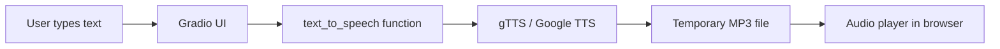

<div align="center">

# TTS Studio

**Turn text into natural-sounding speech in seconds.**
A lightweight web app built with Python, Gradio and gTTS.


[Features](#features) | [Quick Start](#quick-start) | [How It Works](#how-it-works) | [Project Structure](#project-structure) | [Roadmap](#roadmap)

</div>

---

## Features

| Feature | Description |
|---|---|
| **Multi-language voices** | English (US, UK, Australia), Spanish, French, German and Japanese |
| **Slow mode** | Slower speech, useful for language learning |
| **Instant playback** | Generated audio plays directly in the browser |
| **Input validation** | Friendly error messages instead of crashes |
| **One-click launch** | Windows launcher scripts, no terminal needed |
| **Easy to extend** | Add a new voice by adding one line to a dictionary |

---

## Preview

> Add a screenshot of your app here:
>
> ``

---

## Quick Start

### Prerequisites

- Python **3.9 or newer** (3.12 recommended)
- An internet connection (gTTS uses Google's speech service)

### Installation

```bash
# 1. Clone the repository
git clone https://github.com/YOUR_USERNAME/tts-studio.git
cd tts-studio

# 2. (Optional) Create a virtual environment
python -m venv .venv
.venv\Scripts\activate        # Windows
# source .venv/bin/activate   # macOS / Linux

# 3. Install dependencies
pip install -r requirements.txt

# 4. Run the app
python TTS_app.py
```

The app opens automatically in your browser at `http://127.0.0.1:7860`.

### Windows one-click launch

Double-click **`run_app.bat`** to start the app without opening a terminal.

---

## How It Works



1. The user enters text, picks a voice and clicks **Generate Speech**.
2. Gradio passes the inputs to the `text_to_speech()` function.
3. gTTS sends the text to Google's TTS service and receives audio.
4. The MP3 is saved to a temporary file and returned to the Gradio audio player.

---

## Tech Stack

| Layer | Technology |
|---|---|
| Language | Python |
| Web UI | [Gradio](https://www.gradio.app/) |
| Speech engine | [gTTS](https://gtts.readthedocs.io/) |

---

## Project Structure

```
tts-studio/
├── TTS_app.py         # Main application (logic + UI)
├── requirements.txt   # Python dependencies
├── run_app.bat        # Windows launcher
├── run_hidden.vbs     # Windows launcher without console window
├── .gitignore
└── README.md
```

---

## Adding a New Voice

Open `TTS_app.py` and add an entry to the `VOICES` dictionary:

```python
VOICES = {
    ...
    "Italian": ("it", "it"),   # (language code, accent domain)
}
```

Restart the app and the new voice appears in the dropdown.

---

## Roadmap

- [x] Text-to-speech generation
- [x] Multiple languages and accents
- [x] Slow speech mode
- [ ] Download button for generated audio
- [ ] More languages
- [ ] Offline TTS engine option
- [ ] Docker support

---

## Notes

- gTTS requires an internet connection.
- Very long texts may take longer to process.

---

## License

Distributed under the MIT License. See `LICENSE` for details.

---

<div align="center">

Built with Python and Gradio.

If you like this project, give it a star.

</div>